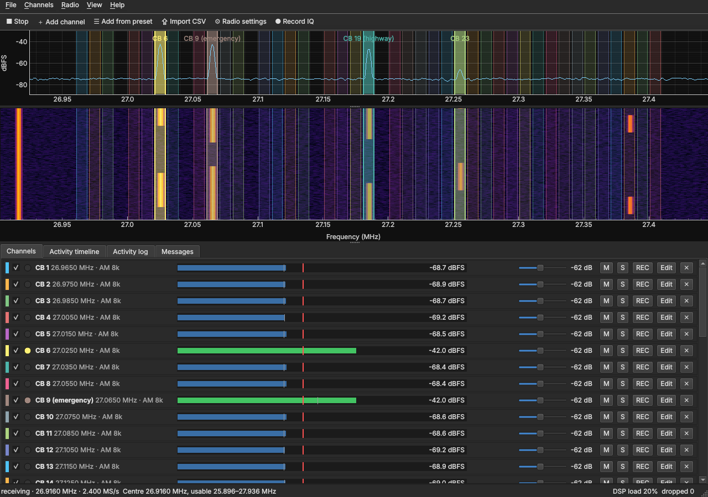

# SDR Multi-Channel Scanner

Monitor several narrowband FM voice channels **at the same time** with a single
RTL-SDR dongle. Every channel inside the dongle's capture bandwidth (about 2 MHz
at 2.4 MS/s) is demodulated in parallel. Each channel has its own squelch,
CTCSS tone, volume, left/right fade and audio output device.



- **Spectrum + waterfall** of the whole captured band. Each channel is marked
  and lights up while its squelch is open. Double-click the spectrum to add a
  channel at that frequency.
- **Channel strips** with a live signal meter (bar, noise-floor tick, red
  squelch line), activity LED, detected CTCSS tone, and squelch, volume, pan,
  mute, solo and record controls.
- **Activity timeline** showing when each channel was active over the last N
  minutes, and an **activity log** (time, channel, frequency, duration, peak
  level, tone, recording) that exports to CSV.
- **Per-transmission WAV recording** (16 kHz mono) per channel.
- **Raw IQ recording** (SigMF) and **IQ file playback**, so you can reproduce a
  problem or try the program without a dongle. **rtl_tcp** network sources are
  also supported.
- Saves and loads channel setups as JSON profiles. The last session is restored
  automatically.

Out of scope: digital voice (P25, DMR, NXDN), trunking, AM/airband, transmit.

---

## Install

### Windows: ready-made .exe (no Python needed)

1. Download `SDRScanner-<version>-win64.zip`. Releases are on the repository's
   *Releases* page. Every build of `main` is also attached to its run of the
   *Windows build* workflow on the *Actions* tab.
2. Extract the zip anywhere, for example `C:\Program Files\SDRScanner` or your
   Desktop. Keep the `_internal` folder next to `SDRScanner.exe`.
3. Install the WinUSB driver with Zadig (step 3 below). It's needed once per
   dongle.
4. Run `SDRScanner.exe`.

Windows SmartScreen may warn about an unrecognised app because the exe isn't
code-signed. Click *More info → Run anyway*. You can build the exe yourself
instead; see [Building the Windows .exe](#building-the-windows-exe).

### Windows: from source

Python 3.10 or newer is required (tested with 3.12 and 3.13).

1. **Install Python** from python.org. Tick "Add python.exe to PATH".
2. **Get the code and install dependencies** (PowerShell, in the project folder):
   ```powershell
   py -m venv .venv
   .venv\Scripts\activate
   pip install -r requirements.txt
   ```
   `pyrtlsdr[lib]` installs `pyrtlsdrlib`, which includes a prebuilt
   `librtlsdr` DLL, so most users need nothing else.
3. **Install the WinUSB driver with Zadig.** This is required once per dongle.
   Windows' default DVB-T TV driver blocks SDR access.
   1. Plug in the dongle. Download Zadig from <https://zadig.akeo.ie/> and run it.
   2. *Options → List All Devices*.
   3. Pick **Bulk-In, Interface (Interface 0)**. It may be called "RTL2838UHIDIR"
      or "RTL2832U". Do *not* pick Interface 1 or your keyboard/mouse.
   4. Check that the USB ID is `0BDA 2838` (or `0BDA 2832`), choose **WinUSB** as
      the target driver, and click **Replace Driver**.
   5. If you later plug the dongle into a different USB port, you may need to
      repeat this.
4. **Run it:** double-click `run_scanner.bat`, or run `python -m sdrscanner`.

#### Using your own librtlsdr.dll (RTL-SDR Blog V4, newer drivers)

The DLL bundled with `pyrtlsdrlib` is the classic osmocom build. **RTL-SDR Blog
V4** dongles need the RTL-SDR Blog driver fork:

1. Download the latest Windows release from
   <https://github.com/rtlsdrblog/rtl-sdr-blog/releases> (`Release.zip`, x64).
2. Copy `rtlsdr.dll` (or `librtlsdr.dll`) and `libusb-1.0.dll` from the zip
   into the folder that holds `SDRScanner.exe` (exe build) or `run_scanner.bat`
   (source checkout).

A `rtlsdr.dll`/`librtlsdr.dll` in that folder is used automatically in place of
the bundled one. You don't need to uninstall anything or change `PATH`.

To check that the library loads, open *Radio settings → Detect devices*. Your
dongle should be listed. You can also run `SDRScanner.exe --self-test report.txt`
(or `python -m sdrscanner --self-test`). It reports which librtlsdr was loaded
and how many dongles it sees.

### Linux

```bash
sudo apt install librtlsdr0 libportaudio2      # Debian/Ubuntu; Fedora: rtl-sdr portaudio
python3 -m venv .venv && . .venv/bin/activate
pip install -r requirements.txt
./run_scanner.sh
```

- Stop the kernel's DVB driver from claiming the dongle:
  `echo 'blacklist dvb_usb_rtl28xxu' | sudo tee /etc/modprobe.d/blacklist-rtl.conf`,
  then unplug and replug the dongle.
- To use the dongle without root, install the udev rules (the `rtl-sdr` package
  ships them), or add your user to the `plugdev` group.
- For RTL-SDR Blog V4, install the rtl-sdr-blog driver build instead of the
  distro `librtlsdr`.

---

## Quick start without hardware

Generate a 60-second synthetic recording with six channels, some with CTCSS,
plus a matching profile:

```bash
python -m sdrscanner.tools.gen_iq demo --seconds 60
python -m sdrscanner demo_profile.json --start
```

You can also play any recording with `python -m sdrscanner --iq capture.sigmf-meta`.

## Using it

1. **Radio settings**: choose the source (RTL-SDR, rtl_tcp or IQ file), sample
   rate, gain/AGC, and PPM correction.
2. **Add channel** (or double-click the spectrum): set the name, frequency and
   bandwidth (12.5 kHz narrow or 25 kHz wide), squelch, hysteresis, hang time,
   CTCSS tone, de-emphasis, volume, pan, output device and recording.
3. Press **Start** (F5).

The status bar shows the chosen centre frequency, the usable span, and any
warning. You get a warning when channels don't fit in the capture bandwidth or
sit on top of the DC spike.

### How the centre frequency is chosen

The usable part of the capture is about 85% of the sample rate (about
2.04 MHz at 2.4 MS/s). The tuner's anti-alias filter rolls off beyond that.
The dongle also has a spike of LO leakage exactly at the tuned frequency. With
*automatic centre* on (the default), the scanner picks the centre that:

1. keeps every enabled channel inside the usable span, and
2. leaves at least 15 kHz between the DC spike and any channel, and otherwise
   stays close to the middle of the channel group.

If the channels span more than the usable bandwidth, it covers the largest
group that fits, marks the rest as *out of band*, and shows a warning. When you
add, move or enable channels while running, the dongle is retuned
automatically. For IQ file playback, the centre is fixed by the recording.

### Squelch

- **Open level** (dBFS): the channel opens when its in-channel power reaches
  this level. Click **Auto** to set it 8 dB above the measured noise floor (the
  grey tick on the meter).
- **Hysteresis**: once open, the channel stays open until the signal drops this
  many dB below the open level. This stops it flapping on weak signals.
- **Hang time**: how long the channel stays open after the signal goes away.
  This bridges short fades and pauses in speech.
- **CTCSS**: when set, the channel only opens if that tone is present. The
  detected tone is shown on the strip for every channel either way, which helps
  you find out what tone a channel uses. The tone must be confirmed first, so a
  tone-squelched channel opens about 0.5 s after the carrier appears.

### Audio routing

Each channel picks an output device. Channels on the same device are mixed.
**Pan** fades the channel between left and right: at centre, both sides play at
full level. **Solo** on any channel mutes every channel that isn't soloed.

### Files

| What | Where / format |
|---|---|
| Profiles | Any `.json` (*File → Save profile*). The last session is saved to `%APPDATA%\SDRScanner\last_profile.json` or `~/.config/SDRScanner/` |
| Transmission recordings | `~/SDRScanner/recordings/` (configurable), `YYYYmmdd_HHMMSS_<channel>_<MHz>.wav` |
| IQ recordings | Same folder, SigMF `cu8` (`.sigmf-data` + `.sigmf-meta`), about 4.8 MB/s at 2.4 MS/s |
| Activity log | *File → Export activity log (CSV)* |

Supported IQ playback formats: SigMF (`cu8`, `ci8`, `ci16_le`, `cf32_le`); WAV IQ
from SDR#/SDR++/HDSDR (centre frequency read from the `..._146520000Hz_...`
file name); and raw `.cu8`/`.bin` (rtl_sdr), `.cs8`, `.cs16`, `.cf32`/`.cfile`.
Enter the centre frequency and sample rate in settings if the file name doesn't
contain them.

### rtl_tcp

Run `rtl_tcp -a 0.0.0.0 -s 2400000` on the machine with the dongle. Then choose
*rtl_tcp server* in Radio settings and enter its address. Gain, PPM and retuning
all work over the network. rtl_tcp carries 4.8 MB/s at 2.4 MS/s, so use a wired
link or a low sample rate.

---

## How it works

```
 reader thread                 DSP thread                                     audio callbacks
 ┌───────────┐  chunks   ┌──────────────────────────────────────────────┐   ┌──────────────┐
 │ RTL-SDR / ├──────────►│ FFT (shared) ─► per channel: bin select ×H   ├──►│ jitter buffer│─► device 1
 │ rtl_tcp / │  queue    │   ─► IFFT (=48 kHz) ─► FM discriminator      │   │ per device   │─► device 2
 │ IQ file   │           │   ─► CTCSS detect / squelch / de-emph / BPF  │   └──────────────┘
 └───────────┘           │   ─► volume/pan mix per device, WAV, log     │
                         └──────────────────────────────────────────────┘
                                        │ snapshots (25 Hz)
                                        ▼
                                  Qt GUI thread
```

- **Channelizer** (`sdrscanner/dsp.py`): an overlap-save fast-convolution
  filter bank. One FFT of the wideband signal (51 200 points at 2.4 MS/s, 75%
  hop) is shared by all channels. Each channel takes the bins around its
  frequency, applies its channel filter, and does a 1024-point inverse FFT. That
  extracts, filters and decimates the channel straight to 48 kHz in one step.
  A per-frame phase correction and a fine NCO make the result identical to a
  continuous mixer, so there are no clicks at block boundaries. Each extra
  channel costs about 1–2% of one CPU core.
- **Demodulation**: quadrature discriminator, then 750 µs de-emphasis
  (switchable), then a 300–3000 Hz voice band-pass, which also removes the
  CTCSS tone.
- **CTCSS**: the discriminator output is low-passed and decimated to 3 kHz.
  The 51 standard tones are measured over a 0.5 s window, and a tone is accepted
  only when it dominates the sub-audio band in several estimates in a row.
- **Threads**: the USB/network/file reader, the DSP, and each PortAudio
  callback run off the GUI thread. The GUI polls a snapshot 25 times a second
  and never blocks. If the DSP falls behind, the oldest chunks are dropped and
  counted in the status bar.
- **Disconnects**: if the dongle is unplugged or the rtl_tcp connection drops,
  the status changes to "waiting for source". The reader retries every 2 s and
  carries on when the device is back.

## Development

```bash
pip install -r requirements-dev.txt
python -m pytest
```

The tests cover the channelizer (SINAD with a tone, adjacent-channel rejection
and continuity at every supported sample rate), squelch, CTCSS, the planner,
profiles, every file format, rtl_tcp against a fake server, an end-to-end
engine run on generated IQ, and a headless GUI smoke test. On a headless Linux
box, run with `QT_QPA_PLATFORM=offscreen`.

### Building the Windows .exe

From PowerShell in the project folder:

```powershell
powershell -ExecutionPolicy Bypass -File packaging\build_windows.ps1
```

The script:
1. creates a clean `.venv-build` environment and installs the dependencies
   plus PyInstaller;
2. builds `dist\SDRScanner\SDRScanner.exe` from `packaging\sdrscanner.spec`;
3. runs the exe's self-test;
4. zips the folder to `dist\SDRScanner-<version>-win64.zip`.

Add `-OneFile` for a single `SDRScanner.exe`. It starts slower because it
unpacks itself on every launch, and antivirus flags it more often.

The bundle includes Python, Qt, NumPy/SciPy, PortAudio (from `sounddevice`) and
librtlsdr (from `pyrtlsdrlib`, with libusb statically linked). Users only need
the Zadig driver.

The *Windows build* GitHub Actions workflow (`.github/workflows/windows-build.yml`)
does the same on every push and pull request. It runs the test suite on
Windows, builds the exe, runs its self-test, and uploads the zip as an
artifact. To publish a GitHub release with the zip, either push a tag such as
`v0.0.1`, or run the workflow manually on `main` (*Actions → Windows build →
Run workflow*) with *release_tag* set. A manual run creates the tag for you. In
both cases the tag must match the app version. When you bump the version, update `sdrscanner/__init__.py`,
`pyproject.toml` and `packaging/version_info.txt`.

`--self-test` checks the DSP chain, PortAudio, librtlsdr loading, and the GUI
with an IQ playback run. No dongle or sound card is needed. It exits non-zero on
failure, and because the exe has no console window, it writes its report to the
file you name.

Package layout:

```
sdrscanner/
  config.py     data model + JSON profiles
  planner.py    centre-frequency selection, DC-spike avoidance, band warnings
  dsp.py        channelizer, FM demod, CTCSS, squelch, spectrum
  sources.py    RTL-SDR, rtl_tcp, IQ file sources
  audio.py      per-device output streams, jitter buffer, pan law
  activity.py   activity events, CSV export, WAV + IQ recorders
  engine.py     reader/DSP threads, retuning, mixing, GUI snapshots
  gui/          PySide6 + pyqtgraph user interface
  native.py     librtlsdr DLL discovery (user-supplied DLL overrides the bundled one)
  selftest.py   --self-test installation check
  tools/gen_iq.py  synthetic multi-channel test-signal generator
packaging/      PyInstaller spec, launcher, icon, Windows build script
```

## Troubleshooting

| Symptom | Fix |
|---|---|
| "librtlsdr could not be loaded" | Install `pyrtlsdr[lib]`, or put `librtlsdr.dll`/`rtlsdr.dll` + `libusb-1.0.dll` next to `SDRScanner.exe` / `run_scanner.bat` (Windows). On Linux install `librtlsdr0`. Run `--self-test` to see which library is picked up. |
| "Cannot open RTL-SDR #0" (retrying) | Windows: redo the Zadig step for Interface 0. Linux: blacklist `dvb_usb_rtl28xxu` and check udev permissions. Close other SDR programs, since only one can use the dongle. |
| Channels are a few kHz off | Set *Frequency correction (ppm)*. Tune a known signal and adjust until it sits centred in its marker. |
| Choppy audio, "dropped" counter rising | Lower the sample rate, use fewer channels, or close CPU-heavy programs. Check the *DSP load* figure in the status bar. |
| Image of a strong signal mirrored around the centre | This is RTL-SDR IQ imbalance. Lower the gain, or move the channel by changing the manual centre. |
| "Audio disabled: PortAudio library not found" (Linux) | `sudo apt install libportaudio2` |
